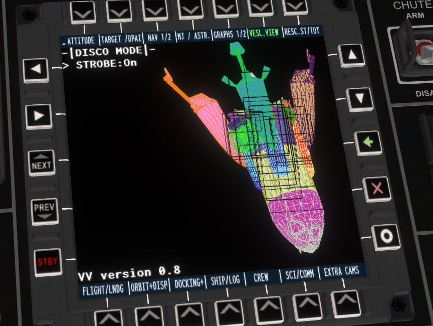

# VesselView Disco Display Fix (for KSP 1.8 – 1.12.5)



Restores the dormant **Disco Display** mode in **VesselView / VesselViewer Continued** by providing the missing `VesselViewPlugin.dll` assembly bridge.

---

### For nearly 12 years,
every installation of modern VesselView has included an orphaned 2015 file called `VVDiscoDisplay.dll`. During flight loading, this file threw an unhandled exception in `KSP.log`:

```text
[ERR] ADDON BINDER: Cannot resolve assembly: VesselViewPlugin
[EXC] FileNotFoundException: Could not load file or assembly 'VesselViewPlugin'
```
Because modern VesselView renamed its main assembly from `VesselViewPlugin.dll` to `VesselView.dll`, the Disco Mode plugin easter egg could never initialize. There is no footage of the effect available anywhere.

### The Solution:
After the smallest amount of digging, it was found that modern VesselView still possesses the complete custom color delegate engine required for this ancient effect. This repository provides a lightweight 3 line bridge assembly (`VesselViewPlugin.dll`) that intercepts the legacy registration call and unlocks the custom menu inside cockpit MFD terminals without any game crashes.

---

### Installation:
1. Make sure you already have **VesselView** and **RasterPropMonitor** (or **MOARdV / MAS**) installed.
2. Download `VesselView-DiscoFix.zip`.
3. Extract the zip.
4. Drag the GameData folder from the zip into your main KSP directory (merging with your existing GameData), or drop the VesselView folder directly into your KSP GameData.

---

### How to Use In-Game
1. Hop into any cockpit with an interactive MFD screen.
2. Open **VesselView** on your screen.
3. Navigate to **Mode** / **Custom Modes** →  **Disco Mode**.
4. Toggle **STROBE** or **GRADIENT** to activate full cockpit RGB mode.
5. *(Optional)* Switch **Vessel Orientation** to **Isometric** or **Relative** for 3D tumbling.

Unfortunately, Disco Mode does not persist outside of the Disco Mode menu smh.

---

### License
Licensed under the [MIT License](LICENSE). 
Original VesselView by PeteTimesSix / Linuxgurugamer.